<div align="center">

# ⛪ Traqi for Churches
### System Requirements & Software Specification

**Follow every person from their first visit to leadership, and give every pastor a clear view of the people in their care.**

    

</div>

> [!IMPORTANT]
> **This document is kept up to date.** Every change to the system (code, database, demo data or deployment) must be reflected here in the same change, and logged in [§ 18 Change log](#18-change-log).
> Diagrams use [Mermaid](https://mermaid.js.org/). They render on GitHub and in VS Code (with the *Markdown Preview Mermaid Support* extension).

---

## 📑 Contents

| # | Section | # | Section |
|---|---|---|---|
| 1 | [Introduction](#1-introduction) | 10 | [Finance: offerings & fund requests](#10-finance-offerings--fund-requests) |
| 2 | [Stakeholders & personas](#2-stakeholders--personas) | 11 | [Pastoral care: welfare, counselling, prayer](#11-pastoral-care-welfare-counselling-prayer) |
| 3 | [System context](#3-system-context) | 12 | [Classes, courses & Family Life](#12-classes-courses--family-life) |
| 4 | [Architecture](#4-architecture) | 13 | [Messages, notifications & email](#13-messages-notifications--email) |
| 5 | [Roles, permissions & scopes](#5-roles-permissions--scopes) | 14 | [Public pages & links](#14-public-pages--links) |
| 6 | [People & the journey](#6-people--the-journey) | 15 | [Data model](#15-data-model) |
| 7 | [First-timers, follow-up & outreach](#7-first-timers-follow-up--outreach) | 16 | [Non-functional requirements](#16-non-functional-requirements) |
| 8 | [Attendance & check-in](#8-attendance--check-in) | 17 | [Deployment, configuration & testing](#17-deployment-configuration--testing) |
| 9 | [Events & event management](#9-events--event-management) | 18 | [Change log](#18-change-log) |

---

## 1. Introduction

### 1.1 Purpose
This document specifies **what Traqi does, for whom, and under what rules**. It is the single reference for product owners, developers, testers and church administrators.

### 1.2 Scope
Traqi is a multi-church, web-based **church management system** (SaaS) covering:

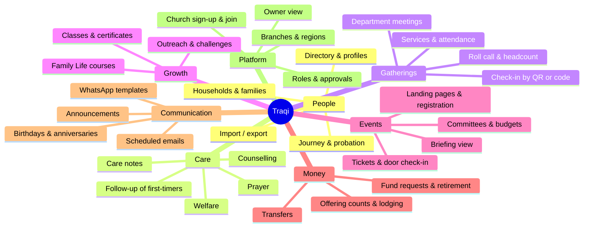

### 1.3 Definitions

| Term | Meaning |
|---|---|
| **Church** | A tenant. All data belongs to exactly one church (`church_id`). |
| **Person** | Anyone the church knows: first-timer, member, worker, leader, child. May or may not have a sign-in. |
| **Journey** | The church's own ordered stages (e.g. First-timer → Member → Worker → Leader). |
| **Department / Unit** | A group. Units sit under a department. Tags (`followup`, `welfare`, `family`…) give a department system duties. |
| **Pastorate** | Lead pastor plus resident/associate pastors. |
| **Demo mode** | Runs on built-in sample data (Heirs Church) saved in the browser; no database. |
| **Live mode** | Runs on Supabase; row-level security enforces every rule. |
| **Lagos time** | All dates, schedules and quiet hours use `Africa/Lagos`. |

---

## 2. Stakeholders & personas

| Persona | Primary goals | Home screen shows |
|---|---|---|
| 👑 **Lead pastor** | See the whole church, decide approvals, care for leaders | Pastor board, who needs care, Ask Traqi, approvals |
| 🧭 **Resident / associate pastor** | Oversee assigned departments and areas | Their areas, overdue follow-ups, welfare/counsel to act on |
| 🗂️ **Admin** | Setup, records, events, roles, roll call of leaders | Setup tasks, joiners to confirm, pending changes |
| 🌱 **Follow-up head** | Receive and assign first-timers; outreach | Follow-up board, 48-hour clock, team load |
| 🎓 **Faculty of Training head** | Run classes and certificates | Courses, sessions, drop-off |
| 💍 **Family Life head** | Marriages, couples' & parenting courses, anniversaries, family events | Families at a glance, family courses, anniversaries, referred cases, committees |
| 🤝 **Welfare head** | Minute and deliver welfare | Welfare queue |
| 🎥 **Media head** | Check-in codes & screens, event pages | Today's service, check-in |
| 🧺 **Head usher** | Headcount and offering counts | Sunday mode |
| 💰 **Finance lead / team** | Income, lodging, fund requests | Requests to review/pay, balances |
| 🏢 **Branch pastor / regional overseer** | Their branch or region | Branch numbers, league table |
| 🙋 **Worker** | Serve, follow up people assigned | My tasks, duties, department meetings |
| 👤 **Member** | Own profile, household, classes, events, requests | Member portal |
| 🆕 **New joiner** | Joined via search, not yet confirmed | Limited portal until confirmed |
| 🛠️ **Traqi owner** | Platform health | Owner view: totals only |

### 2.1 Demo sign-ins

| In-app demo (Heirs Church) | Graceville demo database (`…@graceville.example`, password `Graceville@2026`) |
|---|---|
| Lead pastor · Resident pastor · **Family Life head** · Associate pastor · Admin · Follow-up lead · Department leader (Media) · Head usher · Welfare head · Faculty of Training head · Worker · Member | `lead.pastor` · `resident.pastor` · `associate.pastor` · `admin` · `followup` · `membership` · `media` · `usher` · `welfare` · **`family.life`** · `finance` · `worker` · `member` · `lekki.pastor` · `southwest.overseer` · `new.joiner` (16 sign-ins) |

---

## 3. System context

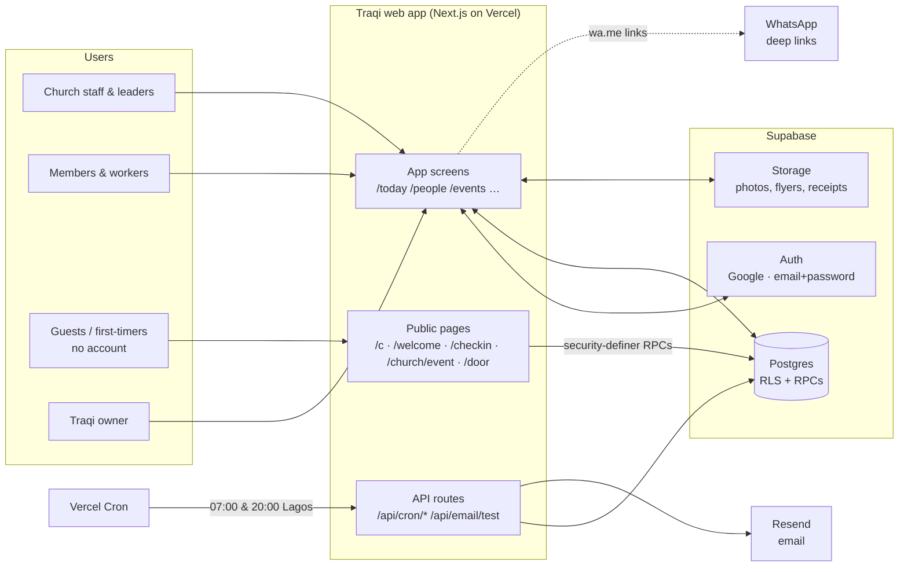

---

## 4. Architecture

### 4.1 Technology stack

| Layer | Choice |
|---|---|
| Framework | **Next.js 15** (App Router), **React 19**, **TypeScript 5.9** |
| Styling | **Tailwind CSS v4**; fonts Bricolage Grotesque (headings), Figtree (text), Fraunces, Archivo |
| Icons | lucide-react |
| Data | **Supabase** (Postgres, Auth, Storage) via `@supabase/supabase-js` |
| Files | `exceljs`, `xlsx` (import/export), `jspdf` (tickets, certificates), `qrcode` (QR), `jsqr` (QR scanning fallback for iPhone) |
| Motion | `lenis` (landing page smooth scroll) |
| Tests | Vitest |
| Hosting | Vercel (or Netlify) + Vercel Cron |

### 4.2 Layered design

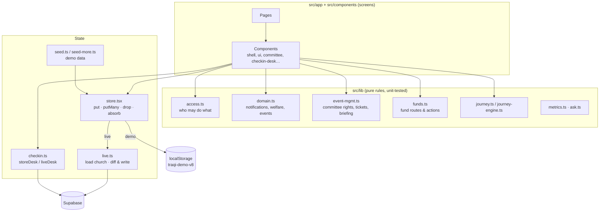

### 4.3 Saving (live mode)

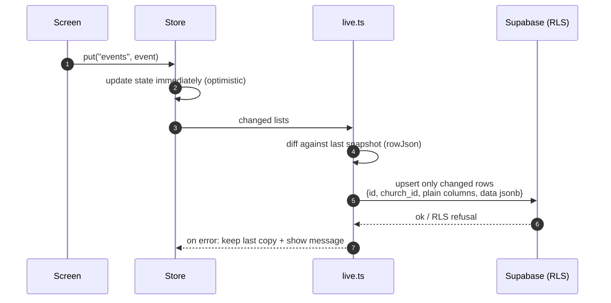

**Requirements**
- **ARC-1** Each collection is stored as `data jsonb` plus a few plain columns used by security rules and filters.
- **ARC-2** Only rows that changed are written. Rows the database just sent are not written back.
- **ARC-3** The database, not the app, is the final authority: every table has row-level security.
- **ARC-4** Sensitive parts live in separate tables: welfare minutes (`welfare_minutes`) and counselling details (`counsel_private`), so the person who asked can't read staff notes.
- **ARC-5** A dropped connection keeps the last saved copy on screen with a message. It never signs the user out.
- **ARC-6** The service worker caches whole pages for offline use only, never the app's own files (the fix for the flickering).

---

## 5. Roles, permissions & scopes

### 5.1 Default roles

| Level | Role | Key permissions |
|---|---|---|
| 1 | **Lead pastor** | *Everything*, plus sensitive abilities and approvals |
| 2 | **Pastorate** | people view/edit/contacts, care.view, follow-up, groups, attendance, classes, events, bulk messages |
| 3 | **Admin** | people, follow-up, groups, attendance, leaders' roll call, classes, events, messages, roles, sheets, activity, billing |
| 4 | Department leader | people view/edit/contacts, groups, attendance, messages |
| 4 | Follow-up lead | follow-up assign/log, contacts, check-in code |
| 4 | Care leader | care.view |
| 4 | Head usher | finance.count, headcount.record |
| 4 | Media head | checkin.code |
| 4 | Finance lead | finance view/transfers/review/approve |
| 5 | Finance team | finance view/transfers/review |
| 5 | Worker | followup.log |
| 6 | Member | none (own profile only) |

Custom and **ready-made roles** can be added. **Sensitive** permissions (`care.view`, `finance.*`…) can only be changed by the lead pastor.

### 5.2 Scopes

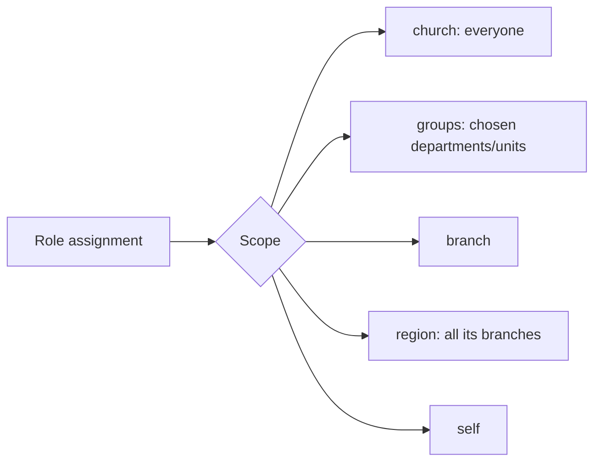

### 5.3 Role-change approval

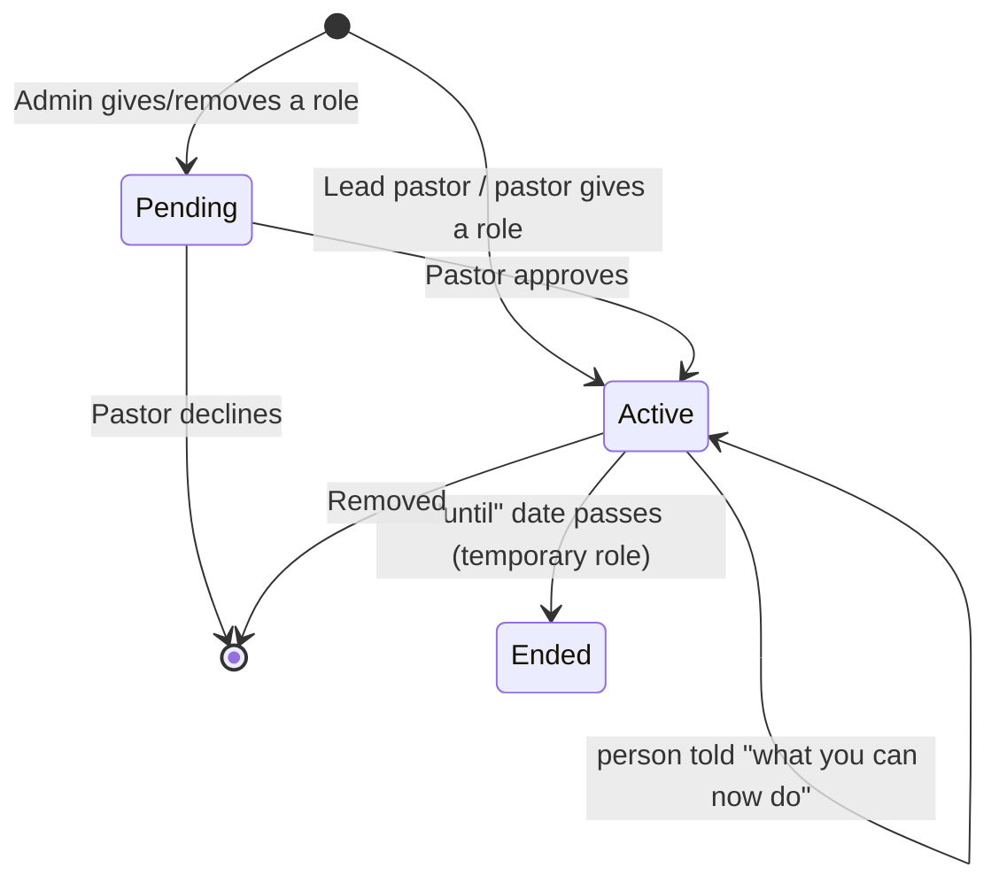

**Requirements**
- **ROL-1** A role can be given to several people at once. Temporary roles have an end date.
- **ROL-2** Admin changes wait for pastor approval (`role_change_guard`). Only the lead pastor changes sensitive abilities (`role_perm_guard`).
- **ROL-3** Department heads can appoint **assistants** with a title and chosen abilities (`people.edit`, `rollcall`, `message`, `followup.assign`, `headcount`, `checkin`…).
- **ROL-4** Derived abilities come from department tags, not roles: leading the `family` department makes someone **Family Life head** (`leadsFamilyLife`). The same applies to training, welfare, follow-up and membership.
- **ROL-5** Branch pastors are limited to their branch *in the app*. ⚠️ *Known gap:* database reads across branches are not yet restricted.

---

## 6. People & the journey

### 6.1 Journey (configurable per church)


- Presets: `class_first`, `members_certified`, `class_to_serve`. Each stage has a kind (visitor, member, worker or leader) and a **rule**: `added`, `returned`, `enrolled`, `class`, `class_confirm` or `manual`.
- **Probation** (optional): it lasts a number of months, can apply to every new worker, and holds back head, assistant or count duties until the person is confirmed.
- The **journey ramp** colours (six indigo shades) are used on avatars, chips and the journey track.

### 6.2 Functional requirements

| ID | Requirement |
|---|---|
| PPL-1 | Directory with search and journey-stage filters. What each person sees follows their role and scope. |
| PPL-2 | A profile shows the journey track, details, missing fields, departments, timeline, care notes and households. |
| PPL-3 | **Care notes**: `care` level for care leaders; `confidential` for the lead pastor only, shareable with named people. |
| PPL-4 | The church adds its own **custom fields** (text, date, choice, yes/no, number), which can be shown on the welcome form. |
| PPL-5 | **Import** from Excel or CSV: column matching, preview, duplicate check by phone number. |
| PPL-6 | **Downloads** (Excel/CSV) are logged. They never include care, welfare or prayer data, hide phone numbers where needed and block spreadsheet formulas. |
| PPL-7 | **Joiners** who find the church in search are "not yet confirmed" until the admin confirms or merges them. Limited after 90 days. |
| PPL-12 | **Birthday: day and month only.** Joining a church (`/join`) and updating details (`/update`) require a birthday, chosen from a day-and-month calendar (`BirthdayPicker`) with no year. Staff may add a year (e.g. for children). A birthday without a year is saved as `1904-MM-DD` (1904 is a leap year, so 29 February works) and is always shown as day and month (`birthdayLabel`, `dayMonth`). Birthday reminders, emails and downloads only ever use the day and month. |
| PPL-8 | **Households** link family members. A marital status (custom `marital`) and anniversary drive Family Life views. |
| PPL-9 | **Inactive** reasons: moved, other church, deceased, other. |
| PPL-10 | **Invite links** (`/invite/[token]`) connect any sign-in to an existing person (`redeem_invite`). |
| PPL-11 | **Activity log**: every change, in Lagos time, append-only. |

---

## 7. First-timers, follow-up & outreach

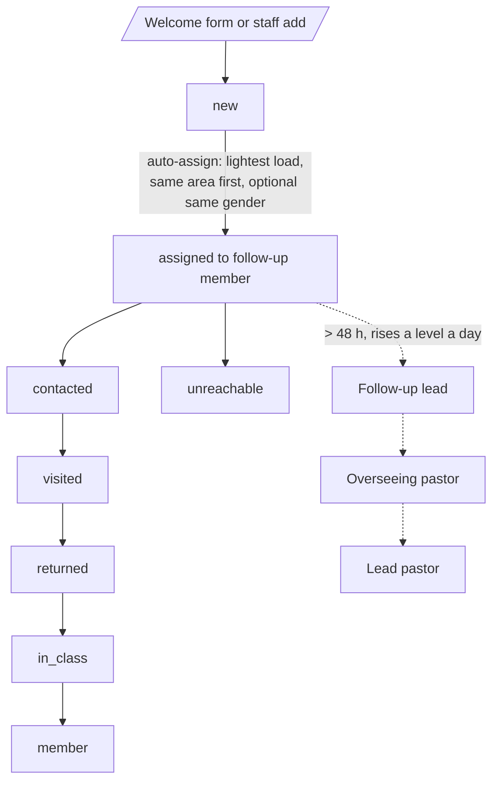

| ID | Requirement |
|---|---|
| FUP-1 | A follow-up board with drag between stages, a 48-hour clock, one-tap call and WhatsApp. |
| FUP-2 | After a Call or WhatsApp tap, the app asks "How did it go?" when the person returns, and logs the answer. |
| FUP-3 | Auto-assignment (`auto_assign_case`, `best_follower`) respects the team the head chose, a load limit, members marked *unavailable* and optional same-gender matching. |
| FUP-4 | The follow-up lead may add **helpers** to a case. |
| FUP-5 | **Outreach**: a named outreach with its own team link. People met are recorded with consent and assigned. |
| FUP-6 | **Challenges**: soul-winning challenges with targets (total and per person) and a league. |
| FUP-7 | **Extra followers**: all leaders and/or whole departments can share follow-up of people met. |

---

## 8. Attendance & check-in

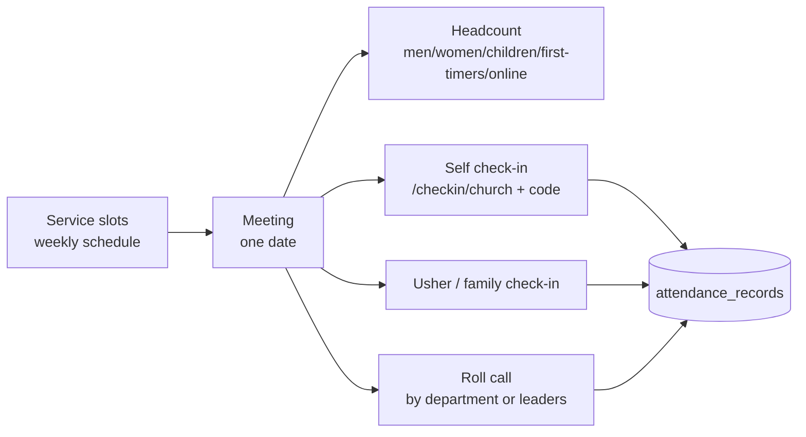

| ID | Requirement |
|---|---|
| ATT-1 | **Sunday mode** headcount by the head usher. Other services take a headcount too. |
| ATT-2 | The public check-in link is **permanent per church**. It needs the service code, is open from 30 minutes before the service until it ends, remembers the phone, and offers "Not you?" and "Add another person". |
| ATT-3 | The projector screen `/display/checkin` shows the QR, the link, the code and a live count. |
| ATT-4 | **Roll call** by department heads, with the admin's leaders' list (and named delegates). Marks: present, late, absent, excused. |
| ATT-5 | "Gone quiet" counts only people whose attendance is tracked. *Away* periods are excluded. |
| ATT-6 | Trends compare with the average of the 4 previous Sundays and with the church's goal. |
| ATT-7 | **Department meetings**: regular (weekly, fortnightly or monthly) or one-off programmes; in person, online or hybrid; members are told again when a meeting changes; **RSVP** "I'll be there" or "Can't make it"; the head sees who's coming. |

---

## 9. Events & event management

### 9.1 Event lifecycle

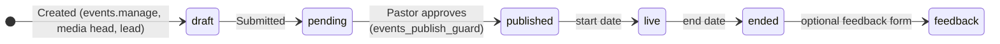

### 9.2 Creating an event
- **Brief**: title, theme, verse, goals, objectives, **target budget**, **registration target** (a goal; *capacity* is the limit).
- **Programme**: days with their own times, sessions, venues (with an overflow venue), speakers and guests with bios.
- **Landing page**: template (Flyer, Bold or Elegant), FAQ, gallery, where to stay, giving, partners, contacts, countdown, "Happening now".
- **Registration**: individual, group or online; configurable questions (text, choice, multi, yes/no, number, date, phone, email; per person); waitlist past capacity; optional approval.
- **The person registering** (always asked): **First name**, **Last name** (separate boxes, saved as `firstName` and `lastName`, with `name` holding both for tickets and the door), **Phone number (your WhatsApp number)** and **Email** are compulsory. **Alternative number (optional - your hotline or call number)** (`altPhone`) sits beneath the phone number and is truly optional: the form and the database accept it blank or in any form.
- **Which questions are compulsory** (`isRequired` in `src/lib/events.ts`): every question is compulsory **except T-shirt size, School or workplace, and Where are you coming from?**, which are optional by default. The organiser's **Required** switch overrides the default for any question. Feedback form questions follow only their own Required switch.

```text
┌──────────────────────── Register ────────────────────────┐
│  First name *              Last name *                    │
│  Phone number (your WhatsApp number) *                    │
│  Alternative number (optional - your hotline or call no.) │
│  Email *                                                  │
│  Gender *            Age range *         …every question *│
│  T-shirt size (optional)          [ Choose a size   ▾ ]   │
│  School or workplace (optional)                           │
│  Where are you coming from? (optional)                    │
└───────────────────────────────────────────────────────────┘
```

| ID | Requirement |
|---|---|
| REG-1 | First and last name are asked separately, and both are compulsory. Older registrations with one name are split for downloads (`splitName`). |
| REG-2 | The phone number is the WhatsApp number and is compulsory, with at least 10 digits. An optional alternative (hotline or call) number is asked beneath it, labelled "Alternative number (optional - your hotline or call number)". Nothing blocks the form if it is left blank. The door search finds people by either number. |
| REG-3 | Email is compulsory and must look like an email address. |
| REG-4 | T-shirt size, school or workplace and where someone is coming from are optional. Every other question is compulsory unless the organiser turns Required off. |
| REG-5 | The database (`register_event`, round 6) checks first name, last name, the alternative number and email from new pages, and still accepts older pages that send one name. |
| REG-6 | A door walk-in asks first name, last name, phone (WhatsApp) number, an optional alternative number and an optional email (to keep the door moving). |
| REG-7 | A dropdown question (e.g. T-shirt size) uses Traqi's own modern dropdown (`ChoiceMenu`), never the browser's default list. On desktop it opens as a menu under the field, and above it when there's no room below. On phones it slides up as a sheet with large rows. It uses the event's colours, works with the keyboard (arrows, Enter, Escape, type a letter) and screen readers (listbox), and respects reduced motion. |

- **How one-choice questions look** (`display`): *Buttons* or *Dropdown list*, set per question in the form builder ("Show as"). **T-shirt size** questions (T-shirt, tee, shirt or jersey) are a dropdown list ("Choose a size") by default, on the registration form, for every person registered and on the feedback form. Existing events need no change (`showsDropdown` in `src/lib/events.ts`).

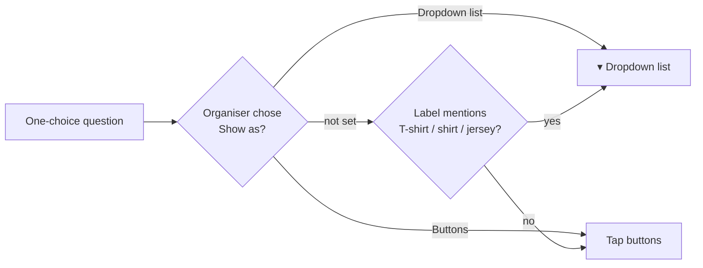
- **Ticket prefix**: e.g. `CH26`, taken from the title and year when left blank.

### 9.3 Committee

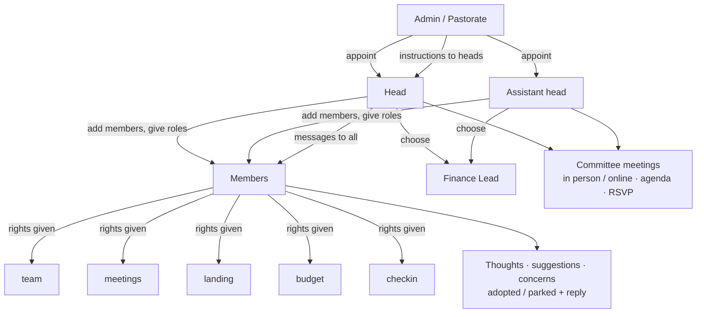

| ID | Requirement |
|---|---|
| EVT-1 | Committee members see their event (even as a draft) and its registrations (`on_committee`). |
| EVT-2 | The head, the assistant head and members given a right may edit the event, its meetings, the page and the teams (`committee_can`). **Publishing still needs a pastor.** |
| EVT-3 | Everyone appointed gets a notice and a box on their Home (`cmt-` and `cmm-` notices). |
| EVT-4 | The **committee workspace** shows the brief with progress against targets, the next meeting, the event link, budgets, notes and members. |
| EVT-5 | The **briefing view** for the Pastorate shows registrations against target, budget, gender and location charts, and the next meeting. It can be presented full screen. |

### 9.4 Event budget workflow

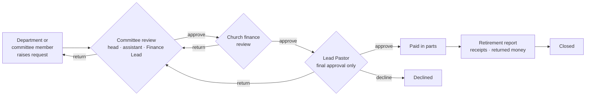

The database enforces this order (`fund_event_guard`): event requests can't skip the committee, and only the Lead Pastor gives the final approval.

### 9.4b Members register through the event page (and join Traqi)

An event page is also a way into Traqi. Before "In person or online", registration offers two choices: **A member of {church}?** (Continue here) and **Invited** (Continue with the form).

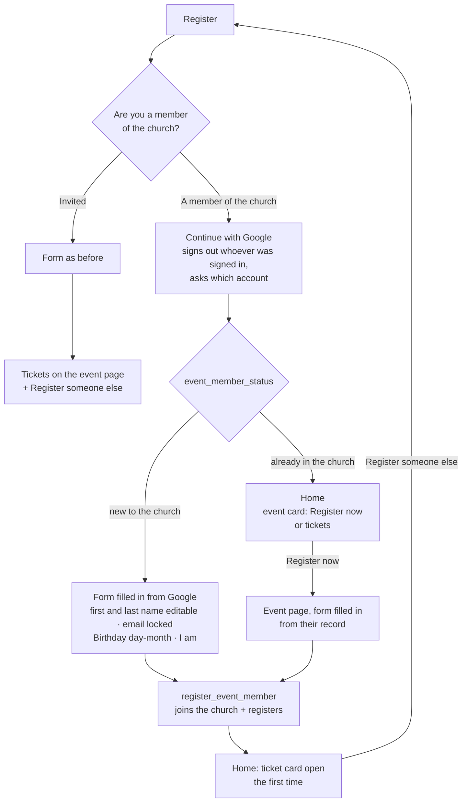

| ID | Requirement |
|---|---|
| MEM-1 | Registration starts with two choices, with no question above them: **A member of {church}?** ("Continue here") and **Invited** ("Continue with the form"). Invited guests keep the earlier flow (in person or online, then the form, then tickets on the page). |
| MEM-2 | *A member of {church}* shows **Continue with Google** with one line: "Continue registration with your Google account. This also creates an account for you if you don't have one." Whoever was signed in on that phone is signed out first and Google asks which account, so a shared phone can register someone else (not spelled out on the page). |
| MEM-3 | Someone already in the church goes straight to their Home. An event they haven't registered for shows **Register now**, which opens the form filled in from their record. |
| MEM-4 | Someone new sees the form filled in from Google. First and last name are editable; the email is the Google email and is locked. After the email: **Birthday (day-month only)**, compulsory, and **I am** (male or female). The event's own Gender question is answered from "I am" and not asked twice. |
| MEM-5 | **Register and join {church}** registers them and joins them to the church as a member, "not yet confirmed" until the admin confirms them (`joined_via = search`, member role). Then they go to Home. |
| MEM-6 | On Home, every event is a collapsible card (`MyEvents`). The title opens the event. The arrow shows the tickets (QR, Image, PDF, Send) and **Register someone else** (back to the event page). A new ticket is open the first time it is seen, then collapsed (`traqi-ticket-seen:<id>` on the device). Staff homes show their own tickets the same way. |
| MEM-7 | A member already signed in who opens an event inside the app skips the question and Google: the form comes filled in and the ticket is theirs. |
| MEM-8 | The demo offers pretend Google accounts: two people already in the church and two new people. |

### 9.5 Duty teams, tickets & door check-in

- **Teams** for follow-up, registration and check-in: whole departments (membership follows the department) and/or named people. A **Registration Lead** manages the teams and may add helpers.
- **Tickets**: `PREFIX-NNNNN` (e.g. `CH26-00125`), numbered in order per event. `next_event_ticket` hands them out under an advisory lock, and a unique-ticket trigger renumbers any duplicate.
- **Shared check-in link** `/door/[token]`: the staff member signs in to use it. *Make a new link* revokes the old one immediately.

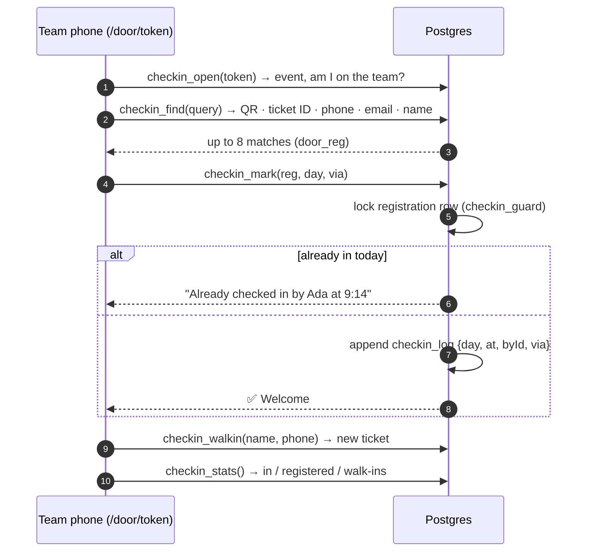

| ID | Requirement |
|---|---|
| CHK-1 | Many phones check people in at once, and no registration is let in twice on the same day. |
| CHK-2 | Each check-in records the day, time, who did it and how (`qr`, `ticket`, `phone`, `email`, `name`, `walkin`). |
| CHK-3 | QR scanning uses `BarcodeDetector`, falling back to `jsqr` (iPhone). The camera needs HTTPS. |
| CHK-4 | Duty members see their duties on Home (`duty-` notices). |

---

## 10. Finance: offerings & fund requests

### 10.1 Offerings

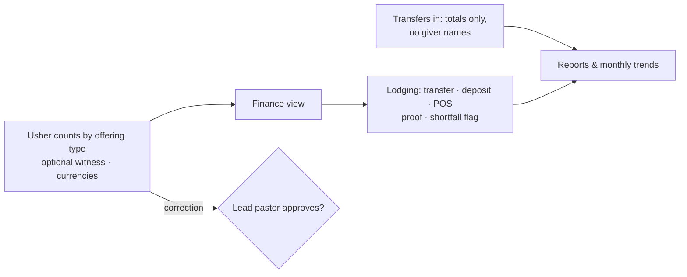

- Offering types are defined by the pastor; a project can have a target. Ushers count only the types marked for them.
- Income can be recorded per branch or at HQ.

### 10.2 Fund requests (non-event)

The church picks one of three **routes**:

| Route | Flow |
|---|---|
| 1 | Requester → **Pastor** → paid |
| 2 *(default)* | Requester → **Finance** review → **Pastorate** → paid |
| 3 | Requester → **Finance** approves and pays up to a limit; above the limit → Pastor |

- A request has line items (quantity × unit, department, receipt), a date or timeline it's needed by, and can be a refund of money already spent.
- It can be paid in parts, then **retired** with a spending report and any money returned, then closed.
- Finance can be limited to named **reviewers**, and balances can be hidden from the finance team. Budgets can be set per department.

---

## 11. Pastoral care: welfare, counselling, prayer

### 11.1 Welfare routing

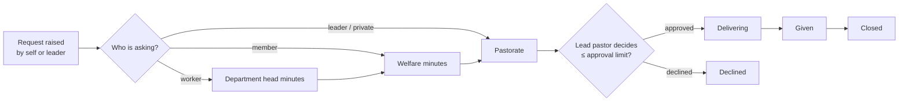

- Each minute records the role, the text, a suggested support and an amount. **Private** requests skip the department. There is a monthly summary.

### 11.2 Counselling
- Requests carry an urgency (urgent, soon or convenient), tags and a description. The description is stored in `counsel_private` and only the person, the handler and the pastor can read it.
- Status: new → forwarded → scheduled (in person, virtual or phone) → referred → done or cancelled.
- The pastor sets up **delegates** (manage, approve, reply, reassign) and can **refer** a case, for example a marriage case to the **Family Life head**.

### 11.3 Prayer
- Members send requests, which can be anonymous. They are seen by the lead pastor, pastors, Membership Ministry and anyone the lead pastor adds (`sees_prayers`). Readers tap "Prayed". Prayer requests are **never downloaded**.

---

## 12. Classes, courses & Family Life

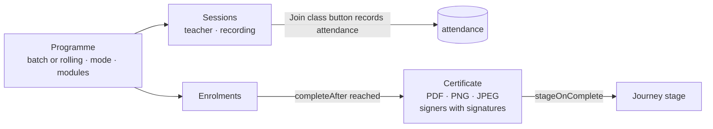

| ID | Requirement |
|---|---|
| CLS-1 | Each church names its course and its parts (default: Course and Lesson). A course can require another first (prerequisite). |
| CLS-2 | Recorded sessions can count toward completion. The course page shows progress and drop-off. |
| CLS-3 | **Owner**: `training` (default) or `family`. Edits by anyone other than the owner wait for the owner's approval (`pendingEdit`). |
| CLS-4 | **Couples' courses**: both partners enrol separately (`partnerId`) and share one certificate. |

### 12.1 Family Life head: what they see

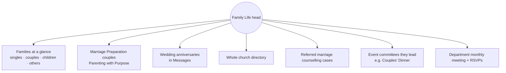

---

## 13. Messages, notifications & email

| ID | Requirement |
|---|---|
| MSG-1 | Birthdays and anniversaries list who already sent wishes ("already sent by"), so a person isn't greeted twice. |
| MSG-2 | Announcements go to everyone, a department, a stage, a course or an event, by email, WhatsApp or in-app. They respect **quiet hours** and can be scheduled. |
| MSG-3 | **WhatsApp templates** by category, with versions, church defaults and personal favourites. They are used on every WhatsApp tap. |
| MSG-4 | **In-app notices** are worked out from the data (`notificationsFor`), and seen keys are kept per device. Prefixes include `cmt-` (committee appointment), `cmm-` (committee meeting), `duty-` (event duty) and `dm-` (department meeting), plus new roles, approvals, joiners, welfare, counselling and fund requests. |
| MSG-5 | Each person sets their own notification choices: announcements, nudge emails, report emails, all email. |

### 13.1 Scheduled emails (Lagos time)

```mermaid
gantt
  dateFormat HH:mm
  axisFormat %H:%M
  title Daily email schedule
  section Quiet hours
  No sending           :crit, 00:00, 6h
  section Morning job
  Daily staff email · Monday summary · event reminders :07:00, 30m
  section Evening job
  Month-end report (last day only) :20:00, 30m
  section Quiet hours
  No sending           :crit, 22:00, 2h
```

- Emails carry **counts only**, never care notes, welfare details or prayer requests.
- Sending stops before the provider's daily limit (100 a day on Resend's free plan). While `EMAIL_SENDING` isn't `on`, every email is logged in `email_log` as *skipped*.

---

## 14. Public pages & links

| Path | Purpose | Data access |
|---|---|---|
| `/` | Marketing landing page (signed out); Home when signed in | none |
| `/signup` · `/start` · `/join` | Start a church; find and join one (smart search tolerates initials and typos) | `create_church`, `find_churches`, `join_church` |
| `/c/[church]` | Church page: welcome, services, map, contacts, socials, live stream, events | `church_page` |
| `/[church]/[event]` (`/e/…` still works) | Event landing page and step-by-step registration with a ticket per person | `event_page`, `register_event` |
| `/welcome` · `/display/welcome` | First-timer form with consent; projector QR | `welcome_first_timer` (write only) |
| `/update` | Members confirm their phone with a code, then fill in missing details | code-verified |
| `/checkin/[church]` · `/display/checkin` | Service check-in | `checkin_public` |
| `/door/[token]` | Event team check-in (sign-in required) | `checkin_*` RPCs |
| `/invite/[token]` | Link an account to a person | `redeem_invite` |

Reserved church addresses (`slug_reserved`) include system paths such as `door`.

---

## 15. Data model

### 15.1 Core entities

```mermaid
erDiagram
  CHURCHES ||--o{ PEOPLE : has
  CHURCHES ||--o{ GROUPS : has
  CHURCHES ||--o{ ROLES : defines
  PEOPLE ||--o{ ROLE_ASSIGNMENTS : holds
  ROLES ||--o{ ROLE_ASSIGNMENTS : grants
  GROUPS ||--o{ GROUP_MEMBERS : contains
  PEOPLE ||--o{ GROUP_MEMBERS : joins
  HOUSEHOLDS ||--o{ PEOPLE : groups
  PEOPLE ||--o{ CARE_NOTES : about
  PEOPLE ||--o{ FOLLOWUP_CASES : followed
  FOLLOWUP_CASES ||--o{ FOLLOWUP_CONTACTS : logs
  PEOPLE ||--o{ PLACEMENTS : "asks to join"
  MEETINGS ||--o{ ATTENDANCE_RECORDS : records
  MEETINGS ||--o{ HEADCOUNTS : counts
  MEETINGS ||--o{ SERVICE_COUNTS : offerings
  PROGRAMMES ||--o{ CLASS_SESSIONS : runs
  PROGRAMMES ||--o{ ENROLMENTS : enrols
  EVENTS ||--o{ REGISTRATIONS : receives
  EVENTS ||--o{ EVENT_NOTES : "committee notes"
  EVENTS ||--o{ FUND_REQUESTS : budgets
  PEOPLE ||--o{ WELFARE_REQUESTS : needs
  WELFARE_REQUESTS ||--o{ WELFARE_MINUTES : minuted
  PEOPLE ||--o{ COUNSEL_REQUESTS : asks
  COUNSEL_REQUESTS ||--|| COUNSEL_PRIVATE : details
  PEOPLE ||--o{ PRAYER_REQUESTS : sends
  PEOPLE ||--o{ MEETING_RSVPS : answers
  OUTREACHES ||--o{ OUTREACH_CONTACTS : meets
  CHALLENGES ||--o{ OUTREACH_CONTACTS : counts
```

### 15.2 Tables

| Group | Tables |
|---|---|
| Tenancy & access | `churches`, `platform_owners`, `roles`, `role_assignments`, `invites` |
| People | `people`, `households`, `groups`, `group_members`, `placements`, `care_notes`, `activity_log` |
| Follow-up & outreach | `followup_cases`, `followup_contacts`, `outreaches`, `outreach_contacts`, `challenges` |
| Gatherings | `meetings`, `attendance_records`, `headcounts`, `absences`, `meeting_rsvps` |
| Classes | `programmes`, `class_sessions`, `enrolments` |
| Events | `events`, `registrations`, `event_notes` |
| Money | `service_counts`, `lodgements`, `transfers`, `fund_requests` |
| Care | `welfare_requests`, `welfare_minutes`, `counsel_requests`, `counsel_private`, `prayer_requests` |
| Communication | `message_templates`, `announcements`, `wishes`, `church_invites`, `email_log` |
| Audit & feedback | `download_log`, `app_feedback` |

Committee, duty teams, check-in link and day plans live inside `events.data`. Each registration's check-in log lives inside `registrations.data`.

### 15.3 Key database functions

| Area | Functions |
|---|---|
| Identity | `my_person`, `my_churches`, `is_lead`, `is_pastor`, `is_owner`, `has_perm`, `is_church_member`, `leads_group`, `heads_tag`, `assistant_has` |
| Sign-up & joining | `create_church`, `slug_available`, `slug_reserved`, `find_churches`, `search_churches`, `join_church`, `merge_joiner`, `claim_person`, `redeem_invite` |
| Follow-up | `auto_assign_case`, `auto_assign_contact`, `best_follower`, `follow_team`, `sees_cases`, `outreach_staff`, `challenge_staff`, `join_challenge` |
| Care | `welfare_staff`, `is_welfare_head`, `counsel_pastor`, `counsel_helper`, `sees_prayers` |
| Events | `event_page`, `register_event`, `new_ticket`, `event_ticket_prefix`, `next_event_ticket`, `events_publish_guard`, `event_feedback`, `committee_picker`, `on_committee`, `committee_can`, `on_duty`, `event_checkin_staff`, `event_manager` |
| Check-in | `checkin_public`, `start_session`, `checkin_open`, `checkin_find`, `checkin_do`, `checkin_mark`, `checkin_walkin`, `checkin_stats`, `checkin_guard`, `door_reg` |
| Finance | `finance_staff`, `fund_event_guard` |
| Guards | `people_self_guard`, `role_change_guard`, `role_perm_guard` |
| Email & owner | `email_recipients`, `email_summary`, `email_event_reminders`, `lagos_today`, `owner_stats`, `set_church_verified` |

### 15.4 Migrations

| File | Adds |
|---|---|
| `0001_foundations` · `0002_review_fixes` | Churches, people, groups, roles, RLS foundations |
| `0003_signup_and_welcome` | Church sign-up, welcome form |
| `0004_v1_features` | Data tables: meetings, attendance, welfare, classes, events, finance, messages |
| `0005_storage_and_fields` | Storage buckets, custom fields |
| `0006_round2` · `0007_roles_journey` · `0008_prayer_and_downloads` · `0009_events_v2` · `0010_email` | Round 2 (bundled as `traqi-database-round-2.sql`) |
| `0011_people_and_teams` | Round 3: join decisions, roll call, outreach |
| `0012_round4` | Round 4: faster sign-in, service jobs, auto-assign, challenges, invitations, funds, counselling, finance roles |
| `0013_event_management` | Round 5: committees, tickets, check-in RPCs, budget guard, `event_notes`, `meeting_rsvps` (also `traqi-database-round-5.sql`) |
| `0015_event_member_join` | Round 7: `event_member_status` and `register_event_member` (also `traqi-database-round-7.sql`) |
| `0014_event_form_names` | Round 6: `register_event` saves first and last name and the alternative number, and requires email (also `traqi-database-round-6.sql`) |

---

## 16. Non-functional requirements

| Category | ID | Requirement |
|---|---|---|
| 🔐 Security | NFR-S1 | Row-level security on every table. Public pages only reach security-definer functions that return what the page needs. |
| | NFR-S2 | The secret key exists only in server environment variables, never in the browser or the code. |
| | NFR-S3 | Confidential data (care notes, welfare minutes, counselling details, prayer) is kept apart, is never exported and is never emailed. |
| | NFR-S4 | Consent is recorded for people added by public forms and outreach. |
| | NFR-S5 | The activity log is append-only, and downloads are logged with who, what and how many rows. |
| ⚙️ Integrity | NFR-I1 | Tickets are unique per event and handed out under a lock. Check-ins lock the row, so nobody is let in twice. |
| | NFR-I2 | Approval order (roles, events, funds) is enforced by database triggers, not only by the app. |
| 📱 Usability | NFR-U1 | Mobile-first: bottom tabs, a floating "Add first-timer" button, touch-friendly roles screen, one-tap call and WhatsApp. |
| | NFR-U2 | The church uses its own words (e.g. "Guest" for first-timer), its own colours (with contrast checked) and its own heading style. |
| | NFR-U4 | Text always has strong contrast against what is directly behind it. Fixed or floating bars (like the homepage header) carry their own background instead of relying on the section under them. |
| NFR-U3 | Plain, friendly language. Dates in Lagos time. |
| ⚡ Performance | NFR-P1 | Sign-in loads the church in one trip. Saves write only what changed. |
| | NFR-P2 | The church's colours paint first, with no flash of the default theme. |
| 🌐 Availability | NFR-A1 | Offline page cache. A dropped connection keeps the last copy on screen. |
| 🧪 Quality | NFR-Q1 | `npm test` must pass (119 tests) and `tsc` must be clean before release. Every saved field must be a real database column (`tests/db-columns.json`). |
| 📈 Scale | NFR-X1 | Multi-tenant by `church_id`, with branches and regions for networks. Plans by member count (free in early access). |

---

## 17. Deployment, configuration & testing

### 17.1 Release pipeline

```mermaid
flowchart LR
  DEV[Local: npm run dev] --> T[npm test · tsc]
  T --> SQL[Run round SQL in<br/>Supabase SQL Editor]
  SQL --> GH[Push src · supabase · tests ·<br/>package.json + lock to GitHub]
  GH --> VC[Vercel builds & deploys]
  VC --> CHK[Check list in DEPLOY-ROUND-N.md]
```

Always run the database update **before** deploying code that needs it. Each round has a `DEPLOY-ROUND-N.md` guide.

### 17.2 Environment variables

| Name | Purpose | Needed for |
|---|---|---|
| `NEXT_PUBLIC_SUPABASE_URL` | Supabase project address | Live mode |
| `NEXT_PUBLIC_SUPABASE_PUBLISHABLE_KEY` | Publishable key (safe to be public) | Live mode |
| `NEXT_PUBLIC_APP_URL` | Live address for links in emails | Email |
| `NEXT_PUBLIC_SITE_URL` | Share picture address | Landing page |
| `NEXT_PUBLIC_DEMO_URL` | Optional "Try the sample church" button | Landing page |
| `SUPABASE_SECRET_KEY` | Server-only secret key | Scheduled emails |
| `CRON_SECRET` | Authenticates Vercel Cron | Scheduled emails |
| `RESEND_API_KEY` · `EMAIL_FROM` · `EMAIL_SENDING` | Email provider, sender, on/off switch | Sending email |

Without the two Supabase values the app runs in **demo mode**.

**On localhost** the values live in `.env.local` (never uploaded: `.gitignore`; `.env.example` lists every setting). With them, localhost signs in with **real accounts**: you type the email and password (your own, or a Graceville test login) or use Google; there is no people picker. The sign-in page shows a localhost-only note saying whether it is on real data or, if the key is missing, on demo data and how to switch (DEV-1).

### 17.3 Tests

| Suite | Covers |
|---|---|
| `tests/access.test.ts` | Care notes, welfare, branch pastors, assistants, approvals, end dates |
| `tests/domain.test.ts` | Journey, probation, auto-assignment, Ask Traqi spelling tolerance, downloads |
| `tests/round2.test.ts` · `tests/round4.test.ts` | Events, emails, Lagos scheduling, funds, counselling |
| `tests/events-mgmt.test.ts` | Committee rights, tickets, check-in lookup, briefing, RSVP, T-shirt dropdown, compulsory fields and names (19 tests) |
| `tests/event-join.test.ts` | Names from Google, the return link, answering Gender from "I am", a ticket open the first time only |
| `tests/birthday.test.ts` | Day-month birthdays, 29 February, years staff record, days to the next birthday |
| `tests/live.test.ts` + `db-columns.json` | Every saved field is a real database column |
| `tests/setup.test.ts` · `tests/theme.test.ts` | Church setup, reserved slugs, colour contrast |
| `scripts/demo-church.test.ts` | Builds the Graceville demo SQL, the removal SQL and the logins JSON, and checks each persona's view |

**Rebuilding the demo:**
```bash
DEMO_OUT="$(pwd)/traqi-demo-church.sql" npx vitest run --config scripts/vitest.config.ts scripts/demo-church.test.ts
```
To load it: run `traqi-remove-demo-church.sql`, then `traqi-demo-church.sql`, after the latest round's SQL.

**Updating a Graceville demo that is already loaded, without removing it** (keeps every change made while testing):

| File | What it adds | How it finds people |
|---|---|---|
| `traqi-demo-add-family-life-login.sql` | Only the `family.life@graceville.example` sign-in, linked to the Family Life head | The Family Life department's leader (or Ronke Adeyemi by name) |
| `traqi-demo-add-family-life.sql` | Family Life content: marital statuses (only where blank), married couples' homes and anniversaries (only for people without a home), Marriage Preparation and Parenting with Purpose courses with classes, couples and attendance, a referred marriage case, the Couples' Dinner goals and committee (only what the event lacks), the Family Life team meeting and RSVPs | Name and phone, then name alone if unique; stops and changes nothing if anyone is missing |

Both are safe to run more than once and need rounds 5–7 first. The content file is built from the freshly built demo SQL with `node scripts/demo-family-life.mjs`.

### 17.4 Project layout

```
src/app            screens (Next.js App Router): (app)/ signed-in, public routes, api/cron
src/components     shell, UI kit, feature components
src/lib            types, rules (access, domain, funds, event-mgmt, journey), store, live sync, seed data, email
supabase/          database migrations 0001 → 0015
tests/ scripts/    unit tests, demo church builder
preview/           single-file click-through preview (npm run preview:build)
```

---

## 18. Change log

| Date | Version | Change |
|---|---|---|
| 2026-11-23 | 7.4 | **Demo add-ons for an existing Graceville demo.** `traqi-demo-add-family-life-login.sql` adds only the Family Life head's sign-in; `traqi-demo-add-family-life.sql` (built by `scripts/demo-family-life.mjs`) adds the Family Life demo content to a demo already in the database, matching people by name and phone and keeping anything edited while testing. No change to the app or schema. |
| 2026-11-23 | 7.3 | **Simpler member choice on event registration.** No question above the choices: **A member of {church}** ("Continue here") and **Invited**. The Google step says only "Continue registration with your Google account. This also creates an account for you if you don't have one." |
| 2026-11-23 | 7.2 | **Localhost uses real sign-in.** `.env.local` (Supabase address filled in; paste the publishable key) switches localhost to live mode: type a real or test login, or use Google. A localhost-only note on the sign-in page says which data you are on. Added `.env.example` and a `.gitignore` so keys and build files are never uploaded. |
| 2026-11-23 | 7.1 | **Homepage header readable everywhere.** The landing page header is now a floating frosted bar with its own colours (dark text on light glass; light text on dark glass when the app is set to dark), so the logo, menu and Log in stay readable over any section. Bolder menu links, rounded hover states, and the scroll progress line along the bar. |
| 2026-11-23 | 7.0 | **Round 7: events bring members onto Traqi.** Registration first asks "Are you a member of {church}?". Members continue with Google: people already in the church go to Home; new people get the form filled in from Google (email locked, birthday day-month and "I am" added), and registering also joins them to the church. Home shows events as collapsible cards with the tickets (open the first time) and Register someone else. Migration `0015`. |
| 2026-11-23 | 6.2 | **Alternative number label and rule.** Now reads "Alternative number (optional - your hotline or call number)" on the registration form, and "(optional - hotline or call number)" at the door walk-in. It is truly optional: no check stops the form. |
| 2026-11-23 | 6.1 | **Birthday on joining is day-month only and compulsory.** On **Join a church** (`/join`) and **Update my details** (`/update`), the birthday is compulsory, labelled "Birthday (day-month only)", and picked from a calendar of day and month only, with no year. Staff can add an optional year (e.g. for children) on the profile edit. Birthdays without a year are kept as `1904-MM-DD` and shown as "14 March". **Event form:** the alternative number is now optional; the T-shirt size dropdown is a modern custom dropdown (a menu on desktop, a bottom sheet on phones); the door walk-in asks the alternative number, and the door search finds people by it. Round 6 SQL also updates `checkin_find` and `checkin_walkin`. |
| 2026-11-23 | 6.0 | **Round 6: event registration form.** First name and last name replace "Full name" (also at the door walk-in). The phone number is labelled "(your WhatsApp number)", with a new compulsory **Alternative number (your hotline or call number)** beneath it. Email is compulsory. Every question is compulsory except T-shirt size, school or workplace, and where someone is coming from. The Excel download gains First name, Last name, WhatsApp number and Alternative number columns. Migration `0014`. |
| 2026-11-23 | 5.2 | **T-shirt size as a dropdown list.** One-choice event questions can show as *Buttons* or a *Dropdown list* (form builder › "Show as"). T-shirt size questions default to a dropdown on the public registration form (each person registered) and the feedback form, including existing events. No database change. |
| 2026-11-23 | 5.1 | **sysreq.md created.** Added a **Family Life head** demo login (in-app persona and `family.life@graceville.example`), with demo data for marital statuses, couple households, Marriage Preparation and Parenting courses, a referred marriage case, the Couples' Dinner committee and a Family Life department meeting with RSVPs. |
| 2026-11 | 5.0 | **Round 5: Event management.** Goals and targets, committee workspace and rights, Finance Lead, committee → finance → Lead Pastor budgets, briefing view, duty teams, Registration Lead, numbered tickets, shared door link, QR, ticket, phone and email check-in, department meetings with RSVP. Migration `0013`. |
| 2026-11 | 4.x | Flicker fix (service worker, single load, theme paints first). New marketing landing page. |
| 2026-11 | 4.0 | **Round 4.** Faster sign-in, headcount, media and follow-up check-in, leaders' roll call, auto-assignment and helpers, challenges, church invitations, fund requests, counselling, finance roles. |
| 2026-11 | 3.0 | **Round 3.** Join decisions by heads, roll call, outreach, new-role notices, PDF tickets and certificates, offering types with targets. |
| 2026-11 | 2.0 | **Round 2.** Join and start churches, church look, journey and probation, roles with approval, assistants, pastor's home and Ask Traqi, prayer, new event pages, branches and regions, downloads, scheduled emails. |
| 2026-11 | 1.0 | **v1.** People and follow-up, attendance and check-in, welfare, classes, events, offerings, messages, owner view. |

<div align="center"><sub>Traqi for Churches · System Requirements Specification · keep this file current with every change</sub></div>
